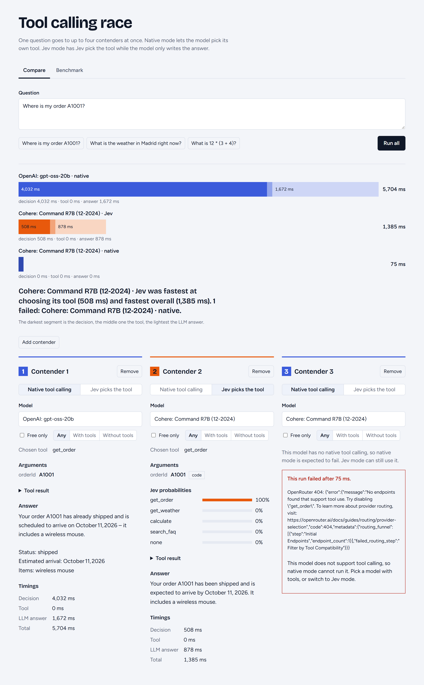
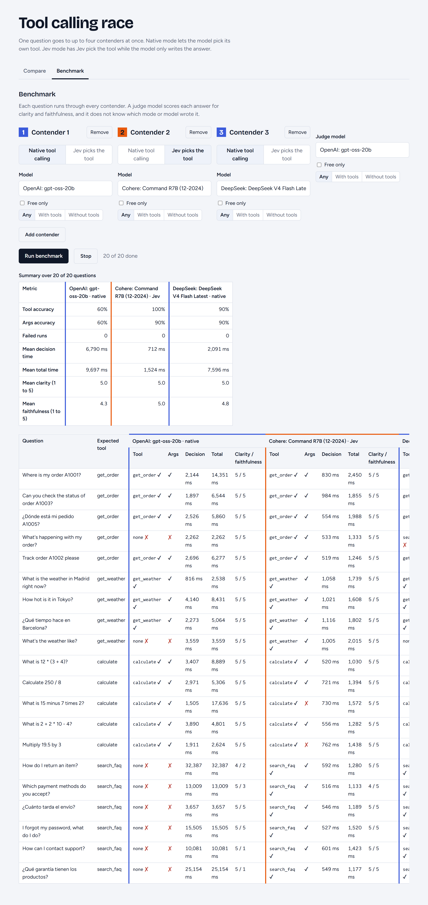
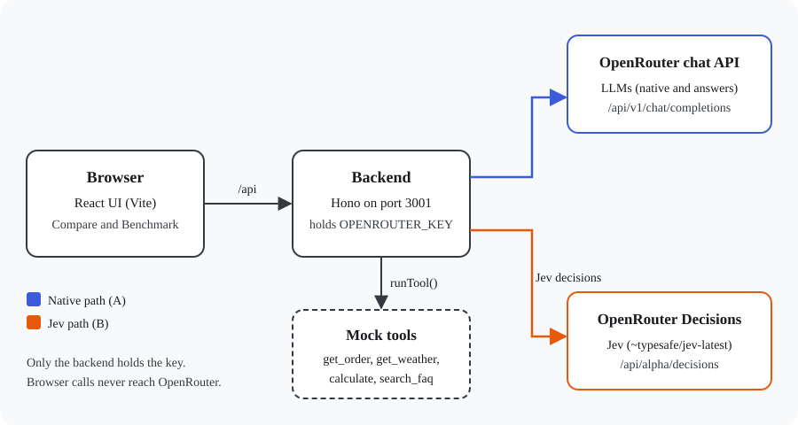
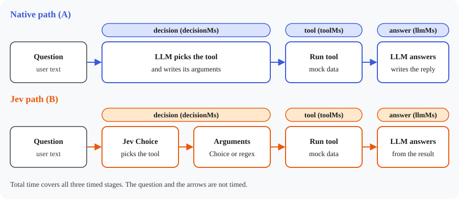
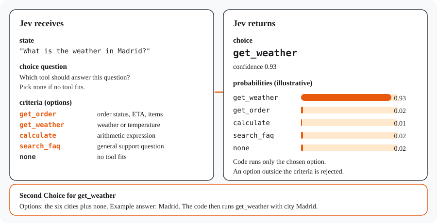

# jev-llm

Tool use for small language models that have no native tool calling. A decision model called Jev picks the tool and its arguments, plain code runs the tool, and the chosen LLM only writes the final answer from the tool result.

This repository is a side-by-side comparison app. It runs one customer question through two paths, native tool calling and a Jev-driven path, and reports which tool was chosen, which arguments were used, the answer, and per-stage timings. A 20-question benchmark measures tool and argument accuracy and scores answers with a judge model.





## The core idea

A small model without native tool calling cannot call a tool by itself. It has no tool-call output format, and the OpenRouter request that would carry tool definitions is not something it can use. The usual fix is a larger model with native tool calling.

jev-llm splits the job instead:

1. **Jev decides the tool.** Jev receives the question and a closed list of options (tools, then cities when needed) and returns one option with probabilities. It never returns free text.
2. **Code runs the tool.** Arguments come from either a Jev choice over a closed set or a regular expression in code. The four tools are local mock functions.
3. **The LLM writes the answer.** The model only sees the question and the tool result, and writes the reply. It never has to pick a tool or produce a tool-call format.

So the answering model can be one that has no tool support at all. In the Compare view, a no-tools model in native mode fails because OpenRouter rejects the tool definitions, while the same model in Jev mode still answers from the real tool result.

## How it works

Both paths are implemented in `server/run.ts`, as `runPathA` (native) and `runPathB` (Jev). Each records three timed stages: `decisionMs`, `toolMs` and `llmMs`, plus `totalMs`.

### Native path (A)

1. `runPathA` sends the question with `toolDefs` (from `server/tools.ts`) through `chat()` in `server/openrouter.ts`. This call is timed as `decisionMs`.
2. If the reply has no `tool_calls`, the reply text is returned as the answer and no tool runs.
3. Otherwise the model's `function.arguments` string is parsed by `parseArgs`. It must be a JSON object, or the run fails.
4. `runTool(name, args)` runs the tool (`toolMs`).
5. A second `chat()` call, without tools, receives the original question, the assistant's tool-call message, and a `tool` message with the JSON result. Its system message is the shared `ANSWER_STYLE` (`llmMs`).

The native path has no grounding instruction of its own. The model writes the answer from the conversation, including the tool result.

### Jev path (B)

1. `runPathB` calls `decider.decide(question)`. In the app this is `createJevDecider(deciderModel)` from `server/decider.ts`. This step is timed as `decisionMs` and includes the argument resolution below.
2. `runTool(decision.tool, decision.args)` runs the tool (`toolMs`). If Jev chose `none`, no tool runs and `toolResult` is `null`.
3. A single `chat()` call (`llmMs`) gets the system prompt `ANSWER_SYSTEM_PROMPT` and a user message of this form:

   ```
   Question: Where is my order A1001?
   Tool used: get_order
   Facts from the tool:
   - orderId: A1001
   - status: shipped
   - eta: 2026-10-11
   - items: ["wireless mouse"]
   ```

   The request has no `tools` field, so the answering model cannot call a tool.

#### The Jev Decisions API

Jev is called through OpenRouter at `POST https://openrouter.ai/api/alpha/decisions` (`jevDecide` in `server/openrouter.ts`). The model is `~typesafe/jev-latest` (`JEV_DEFAULT_MODEL` in `server/decider.ts`). Only `choice` questions are sent.

Request (trimmed; the `criteria` object lists every tool, and `none`):

```json
{
  "model": "~typesafe/jev-latest",
  "state": { "question": "What is the weather in Madrid right now?" },
  "questions": {
    "choice": {
      "type": "choice",
      "instructions": "Which tool should answer this question? Pick none if no tool fits.",
      "criteria": {
        "get_order": "The user asks about the status, ETA or items of an order.",
        "get_weather": "The user asks about the weather or temperature in a city.",
        "...": "...",
        "none": "No tool fits; anything else."
      }
    }
  }
}
```

Response (trimmed; the numbers are illustrative):

```json
{
  "model": "~typesafe/jev-latest",
  "answers": {
    "choice": {
      "type": "choice",
      "choice": "get_weather",
      "confidence": 0.93,
      "probabilities": { "get_weather": 0.93, "get_order": 0.02, "none": 0.01, "...": 0.04 }
    }
  },
  "usage": { "input_tokens": 0, "output_tokens": 0 }
}
```

The code reads `res.answers.choice`. It throws if the answer is not a `choice`, and it throws if `choice` is not a key of the criteria it sent, so an invalid value cannot reach `runTool`. Jev's `probabilities` and `confidence` are returned in the run result and shown in the UI.

#### Argument resolution

Jev cannot write free text, so each tool argument comes from one of two sources. `Decision.argSource` records which one (`"jev"` or `"code"`), and the UI shows a chip for each.

| Tool | Argument | Source | How |
| --- | --- | --- | --- |
| `get_order` | `orderId` | code | `extractOrderId`: first match of `\bA\d{4}\b`, case-insensitive, upper-cased. |
| `get_weather` | `city` | Jev | A second Choice question over `CITIES` plus `none`. `none` leaves `city` undefined. |
| `calculate` | `expression` | code | `extractExpression`: first run of digits, operators and parentheses that contains an operator. Number words such as "minus" are not converted. |
| `search_faq` | `query` | code | The full question text. |

When a value is missing, the tool returns `missing_data`. For example `get_order` with no order id returns `{ "error": "missing_data", "missing": ["orderId"] }`, and the answering prompt tells the model to ask the user for that item. An unknown city returns `missing_data` with the list of allowed cities.

#### Shared answer style

Both paths use the same style instruction, `ANSWER_STYLE` in `server/run.ts`: a complete, friendly answer in the user's language, opening with one full sentence that states the key facts, then a short list when the result has several fields, and never raw JSON. Keeping the style identical means the comparison measures who picked the tool, not answer length.

The Jev answering prompt adds grounding rules: use only the facts in the tool result, do not add outside knowledge, ask for `missing_data` items, and say so when the tool is `none`.

## Contenders

The Compare view and the Benchmark view both work with **contenders**. A contender is a model plus a mode.

- You can have 1 to 4 contenders (`MAX_CONTENDERS`).
- Each contender has a mode, `native` or `jev`, and any model. Contenders do not have to share a model.
- The model picker has a search box, a "Free only" checkbox, and a segmented filter with **Any**, **With tools** and **Without tools**. Models without tool support show a "no tools" badge.
- "Add contender" copies the last contender's model and switches its mode. Each contender has its own Remove button.
- The contender list is saved in the browser's `localStorage` under `jev-llm.contenders`. A stored list is used only while every model in it is still listed.
- Defaults: `openai/gpt-oss-20b` in native mode, and `cohere/command-r7b-12-2024` in Jev mode. If those models are not listed, the first matching fallback in `src/defaultModel.ts` is used.

Example: compare "DeepSeek V4 flash" in native mode with "Mistral" in Jev mode. Pick both, type a question, and press **Run all** or Ctrl/Cmd+Enter.

The Jev decider model is not selectable in the UI. The browser sends only `model` and `question`, so the server uses `JEV_DEFAULT_MODEL`.

## Mock tools and benchmark

The four tools have fixed data and no network access (`server/tools.ts`):

| Tool | Arguments | Data |
| --- | --- | --- |
| `get_order` | `orderId` (format `A1001`) | Five fixed orders, `A1001` to `A1005`, with status, ETA and items. Unknown ids return `found: false`. |
| `get_weather` | `city` (closed set) | Six cities: Madrid, Barcelona, London, Paris, New York, Tokyo. |
| `calculate` | `expression` | Local recursive-descent evaluator. It accepts only digits, dots, `+ - * /` and parentheses. |
| `search_faq` | `query` | Six FAQ entries matched by keyword substrings. The entry with the most keyword hits wins. Spanish forms are included. |

The benchmark (`server/dataset.ts`) has 20 labeled questions: 5 order, 4 weather, 5 calculator and 6 FAQ questions. Some are in Spanish. Each item has an expected tool and expected arguments. An expected `null` means the user did not give that value.

The Benchmark view runs items one after another. The contenders for one item run in parallel on the server. Each contender's run is then judged.

## Metrics

**Latency.** Each run reports `decisionMs`, `toolMs`, `llmMs` and `totalMs`, all rounded to whole milliseconds. In native mode `decisionMs` is the tool-choosing LLM call. In Jev mode it is the Jev decision including argument resolution. A run with no tool call has no `toolMs` or `llmMs`. The Benchmark view averages these over the runs that succeeded.

**Tool accuracy.** `toolCorrect` is true when the chosen tool equals the expected tool. Failed runs count as wrong in the percentage.

**Argument accuracy.** `argsCorrect` is judged only when the tool is correct. Each expected argument must match:

- For a value that is given (non-null), the argument must match the expected value. Matching ignores case, accents and whitespace. For the free-text `query` argument, every expected word must appear in the query the path sent, so word order and extra words are allowed.
- For a null gap, the argument passes when the path left it empty, or when the tool returned `missing_data` for that key. The path does not get credit for inventing a value.

**Answer quality.** A judge model (default `openai/gpt-oss-20b`, selectable in the Benchmark view) receives the question, the tool result JSON and the answer. It returns integer scores from 1 to 5 for:

- **Clarity:** how easy the answer is for a non-expert to understand.
- **Faithfulness:** how well the answer states only what the tool result supports.

The judge prompt does not name the mode or the model that wrote the answer. Scores are parsed from the first JSON object that holds both numbers and are clamped to 1 to 5. A judge failure is shown in its row and left out of the means.

## Architecture







The browser never sees the API key. Vite proxies `/api` to the Hono server on port 3001, which holds `OPENROUTER_KEY`.

| File | Responsibility |
| --- | --- |
| `server/index.ts` | Hono app and routes on port 3001. Exits at startup if `OPENROUTER_KEY` is empty. |
| `server/run.ts` | `runPathA` (native) and `runPathB` (Jev), input parsing, answer prompts, stage timings. |
| `server/decider.ts` | `Decider` interface, `createJevDecider`, argument resolution (`extractOrderId`, `extractExpression`). |
| `server/openrouter.ts` | Fetch wrapper for OpenRouter, `chat()`, `jevDecide()`, `fetchModels()`, and the request and response types. |
| `server/tools.ts` | Mock data, `toolDefs` for native calls, `runTool`, and the calculator evaluator. |
| `server/benchmark.ts` | `runBenchmarkItem`, `toolCorrect`, `argsCorrect` (with the null-gap rule), `parseJudgeScores`, judge prompt. |
| `server/dataset.ts` | The 20 benchmark items. |
| `server/models.ts` | `getModels()` with a 10-minute cache, and `toModelInfo` (prices per 1M tokens, tool support, free flag). |
| `server/*.test.ts` | `node:test` tests for each server module above. |
| `src/App.tsx` | Tabs, the question box, Run all, contender columns, race strip. |
| `src/api.ts` | Browser fetch helpers and the shared response types. |
| `src/contenders.ts` | Contender list, storage, defaults, colors. |
| `src/defaultModel.ts` | Default model choice for native, Jev and judge roles. |
| `src/components/ModelPicker.tsx` | Searchable model picker with the free and tool filters. |
| `src/components/ContenderEditor.tsx` | Heading, mode, model and remove control for one contender. |
| `src/components/ContenderColumn.tsx` | One Compare column: chosen tool, arguments, probabilities, tool result, answer, timings. |
| `src/components/RaceStrip.tsx` | Bar comparison of total time per contender after a run. |
| `src/components/BenchmarkView.tsx` | Benchmark runner, summary table and per-question results. |
| `src/format.ts` | Millisecond formatting and plain-text cleanup of answers. |
| `PLAN.md` | The original MVP plan and milestones. |

## API reference

All bodies are JSON. Errors are returned as `{ "error": "..." }`, and run errors also include `path` and `timings`.

| Method and path | Request body | Response |
| --- | --- | --- |
| `GET /api/models` | none | Array of `{ id, name, tools, free, promptPrice, completionPrice, contextLength }`. Prices are USD per 1M tokens. Cached for 10 minutes. |
| `POST /api/run/a` | `{ "model": string, "question": string }` | Path A result: `path`, `model`, `tool`, `args`, `toolResult`, `answer`, `timings`. |
| `POST /api/run/b` | `{ "model": string, "question": string }` | Path B result: as above, plus `deciderModel`, `argSource` and `probabilities`. |
| `GET /api/benchmark/items` | none | Array of `{ id, question, expectedTool }`. |
| `POST /api/benchmark/item` | `{ "itemId": string, "contenders": [{ "id": string, "mode": "native" or "jev", "model": string }], "judgeModel": string }` | `{ itemId, question, expectedTool, results }`. Each result has `contenderId` and either `result`, `toolCorrect`, `argsCorrect` and `judge`, or `error`. |

Input errors return status 400. Upstream and run errors return 502 (or the status set on `RunError`). `contenders` must hold 1 to 4 entries with unique ids. `itemId` must be one of the dataset ids. `deciderModel` is accepted by `parseRunInput` but the browser does not send it.

## Setup and run

Requirements: Node.js and an OpenRouter API key.

1. Clone the repository and install dependencies:

   ```
   git clone <repository-url> jev-llm
   cd jev-llm
   npm install
   ```

2. Create a `.env` file in the project root:

   ```
   OPENROUTER_KEY=sk-or-...
   ```

   The file is listed in `.gitignore`. Do not commit it.

3. Start the API (port 3001) and the web app (port 5173):

   ```
   npm run dev
   ```

   On machines where Windows Device Guard or policy blocks `npm`, run `node --run dev` instead. The same applies to the other scripts, for example `node --run test`.

4. Open http://localhost:5173.

Other scripts:

```
npm test          # node:test, runs server/**/*.test.ts
npm run build     # tsc --noEmit, then vite build
```

## Example run

One full benchmark run (20 questions, judge `openai/gpt-oss-20b`), shown in the second screenshot above. Times are means over the 20 questions. Single run, so expect variation.

| Contender | Tool accuracy | Args accuracy | Mean decision | Mean total |
| --- | --- | --- | --- | --- |
| `openai/gpt-oss-20b`, native | 60% | 60% | 6,790 ms | 9,697 ms |
| `cohere/command-r7b-12-2024` (7B, no tools), Jev | 100% | 90% | 712 ms | 1,524 ms |
| `deepseek/deepseek-v4-flash` (latest alias), native | 90% | 90% | 2,091 ms | 7,596 ms |

How to read it: the native contenders are reasoning-style models, so their answer step is slow too. The Jev contender answers with a small non-reasoning model, so part of its total-time lead comes from the answering model and not only from who chose the tool. Its 90% argument accuracy comes from two calculator questions written with words ("15 minus 7 times 2", "Multiply 19.5 by 3") that the regex does not read. The native models missed several FAQ and under-specified questions by answering without a tool; the scoring counts that as wrong.

## Findings and limitations

These are observations from the author's runs and from the code. They are not a general benchmark.

- **Decision speed.** In the author's runs, a Jev decision took about 0.5 s per call. A native tool-choosing LLM call took 1.4 to 7 s. Jev is faster at choosing the tool, but this does not make the whole answer faster.
- **Total time is dominated by the answering LLM.** Both paths end with an LLM call that writes the answer, so the answering model's latency usually decides the total.
- **Jev cannot produce free text.** Arguments that are free values need a regular expression in code or a hybrid. Calculator expressions with number words ("minus", "times") are not converted, so in Jev mode `calculate` gets no expression and returns `missing_data`. The benchmark item `calc-03` ("What is 15 minus 7 times 2?") shows this.
- **Small models.** In the author's experiments, models around 1B parameters follow the tool facts poorly, while models around 3 to 8B parameters answer correctly. The default Jev-mode answering model is a 7B model.
- **The benchmark is small and uses mock tools.** It has 20 questions and fixed data. Its accuracy numbers are not proof of accuracy on real systems.
- **The judge is weak.** The judge is an LLM, its scores are indicative only, and it can be wrong about faithfulness.
- **Free models are often rate limited.** OpenRouter returns HTTP 429 for many free models. The UI shows the error and the timings reached. The default contender is the paid model `openai/gpt-oss-20b`.
- **Decider model.** The UI cannot choose the Jev decider model. The server default is always used from the browser.

## Adding another decider (for example Clef)

No Clef code exists in this repository. `server/decider.ts` defines the interface that a Clef implementation would plug into:

```ts
export interface Decider {
  decide(question: string): Promise<Decision>;
}
```

`Decision` has `tool`, `args`, `argSource`, `probabilities` and an optional `confidence`. A new implementation only has to return that shape. `runPathB` accepts a `decider` through its `deps` argument, so tests can inject one. The HTTP route in `server/index.ts` currently builds the Jev decider, so wiring a new decider into the app means changing the route or `runPathB`'s default. Clef is planned to be served through Workers AI or Requesty, not OpenRouter.

## Project status

This is a personal experiment and portfolio project. It is not a product, it has no authentication, no database and no deployment, and it is not supported as a library.
